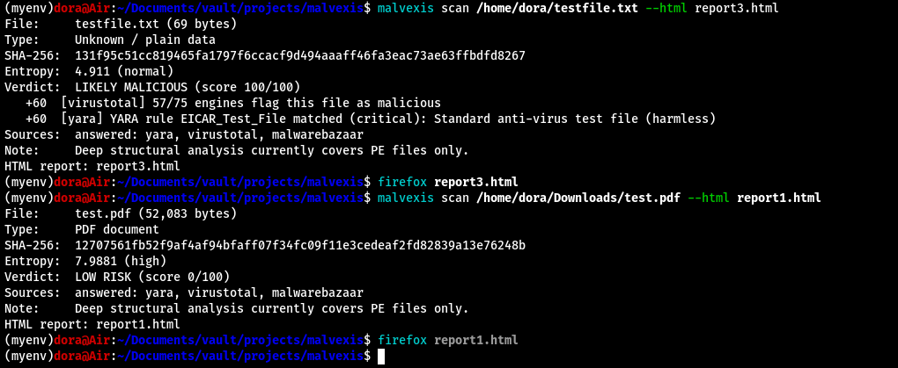
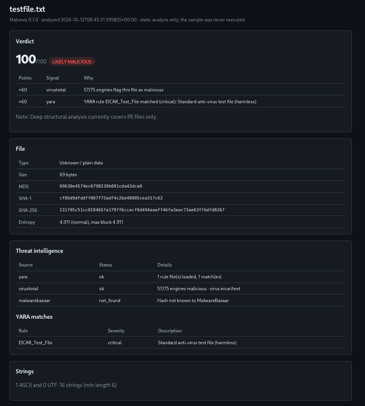
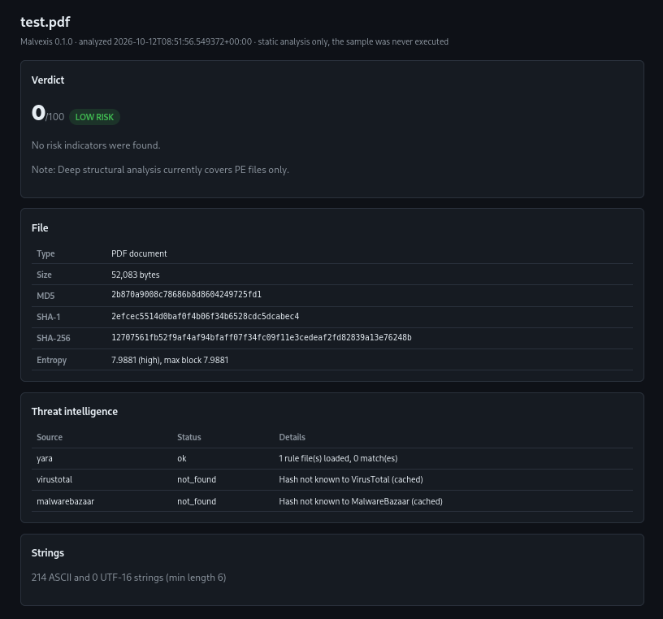

# Malvexis

<p align="center">
  <strong>Fast, offline-first static malware analysis & threat intelligence triage engine.</strong>
</p>

<p align="center">
  
  
  
  
  
  
</p>

---

## Overview

**Malvexis** statically analyzes untrusted files and Windows PE binaries, enriches them with multi-source threat intelligence, and produces a scored risk verdict with an auditable explanation. It extracts forensic metadata and indicators without executing or detonating samples.

* **Safe Static Triage:** Samples are read as raw bytes—never imported, executed, or detonated.
* **Explainable Scoring (0–100):** Every point added or deducted is tied to a human-readable reason.
* **False-Positive Reduction:** Deducts risk points for verified legitimate software via **CIRCL hashlookup** (NSRL baseline).
* **Resilient Architecture:** Network failures, unconfigured API keys, or rate limits degrade gracefully without interrupting scans.
* **Modern Reporting:** Outputs rich terminal summaries, structured JSON, and self-contained dark-mode HTML reports.

---

## Visual Showcase

### 1. Terminal CLI in Action
Scans untrusted samples in seconds, reporting file metadata, entropy, YARA matches, API heuristics, and online intelligence status:



---

### 2. Interactive Dark-Mode HTML Reports
Generates standalone, CSS-contained forensic dossiers detailing verdict rationale, PE header telemetry, threat-intel hits, and extracted strings:

<table>
  <tr>
    <td width="50%" align="center"><strong>Likely Malicious Verdict (EICAR / Trojan)</strong></td>
    <td width="50%" align="center"><strong>Low Risk Verdict (Clean / Benign PDF)</strong></td>
  </tr>
  <tr>
    <td></td>
    <td></td>
  </tr>
</table>

---

## Key Features

| Capability | Details |
|---|---|
| **Streaming Hashing** | MD5, SHA-1, SHA-256, PE `imphash`, and optional `ssdeep` fuzzy hashing (streamed in chunks to prevent memory spikes on large files). |
| **Header & Structure** | Magic-byte validation, extension mismatch detection (e.g. executable disguised as PDF), compile timestamps, and overlay tracking. |
| **Entropy Analysis** | Overall and block-by-block Shannon entropy to detect packed, encrypted, or compressed payloads. |
| **PE Forensics** | Section table analysis (permissions, entropy, raw vs. virtual size), writable+executable (`W+X`) alerts, and exported/imported symbols. |
| **Suspicious API Categorization** | Imports categorized by adversarial capability: Process Injection, Anti-Debugging, Evasion, Persistence, Keylogging, Crypto, and Execution. |
| **Threat Intelligence** | Lookups against **VirusTotal v3**, **MalwareBazaar**, and **CIRCL hashlookup** with local SQLite caching to protect API quotas. |
| **YARA Scanning** | In-process rule compilation and evaluation against samples (built-in custom rules + user-supplied rule folders). |
| **Sandboxed Tool Runners** | Opt-in integration with **Detect It Easy** (packer identification), **ClamAV**, **capa** (ATT&CK capabilities), and **FLOSS** (obfuscated strings). |

---

## How Scoring Works

Malvexis uses a transparent heuristic model rather than a black-box algorithm. The verdict is calculated on a 0–100 scale:
* `0 – 24`: **Low Risk** *(static analysis cannot prove a file is "clean", so Malvexis never reports "clean")*
* `25 – 59`: **Suspicious**
* `60 – 100`: **Likely Malicious**

### Points Distribution
* **Threat Intel:** VirusTotal engine hits (+15 to +60), MalwareBazaar known signature (+50).
* **Known-Good Bonus:** CIRCL hashlookup verified software **deducts 20 points** (`-20`), mitigating false positives on standard administrative and developer binaries.
* **YARA Signatures:** Matched rules add points according to rule severity (+10 low to +60 critical, capped at 60).
* **Structural Heuristics:**
  * Packed section names / DIE identification (+15)
  * High-entropy sections or low import count with elevated entropy (+10)
  * Writable and Executable (`W+X`) sections (+10)
  * Dangerous API clusters (e.g. 2+ Process Injection APIs: +20)
  * Extension mismatch (+10)
  * Embedded URLs, IPs, or suspicious command strings (+5 to +10)

Every report includes a full breakdown table showing exact point additions and rationale.

---

## Quick Start

### Installation

**Option A — One-Step Global Install (Recommended):**

```bash
git clone https://github.com/anilkashyap01/malvexis.git
cd malvexis
chmod +x install.sh && ./install.sh
```
*This sets up an isolated environment and links `malvexis` to `~/.local/bin` so you can immediately run `malvexis` from any terminal without needing to activate virtual environments.*

**Option B — Manual Setup:**

```bash
python3 -m venv .venv
source .venv/bin/activate    # On Windows: .venv\Scripts\activate
pip install -e ".[yara]"
```

(Optional) Copy environment template and configure API keys:
```bash
cp .env.example .env
```

### Basic Usage

```bash
# Basic file scan (terminal summary)
malvexis scan sample.exe

# Generate JSON and self-contained HTML reports
malvexis scan sample.exe --html report.html --json report.json

# Offline mode (skips external network requests; YARA & local analysis still run)
malvexis scan sample.exe --offline

# Batch folder triage (outputs summary list and per-sample reports)
malvexis scan samples_folder/ -r --out-dir reports/

# Pipe raw JSON directly into jq for SIEM / automation pipelines
malvexis scan sample.exe --json - | jq .score
```

### Optional External Tools

Malvexis can orchestrate specialized static analyzers through its audited runner:

```bash
# Run with opt-in analyzers
malvexis scan sample.exe --clamav --capa --floss
```

* **Detect It Easy:** `pip install -e ".[die]"` (analyzes packer/compiler signatures in-process).
* **ClamAV:** `sudo apt install clamav` (signature antivirus scanning).
* **capa:** `pip install -e ".[capa]"` (maps binary capabilities to MITRE ATT&CK techniques).
* **FLOSS:** `pip install -e ".[floss]"` (extracts obfuscated and stack strings).

---

## Security & Safety Architecture

Malvexis is built for security research environments and strictly enforces safety boundaries:

1. **No Execution:** Analysis operates strictly on read-only byte streams. No `os.system`, `ctypes`, `eval`, or dynamic loading.
2. **Defensive Subprocessing:** Subprocesses are restricted to [`src/malvexis/tools/runner.py`](src/malvexis/tools/runner.py) using an explicit allowlist (`capa`, `floss`, `clamscan`), `shell=False`, `stdin=DEVNULL`, hard timeouts, and capped output buffers.
3. **Privacy & OPSEC:** Threat intelligence integrations send SHA-256 hashes only. Sample contents or strings are never uploaded.
4. **Hostile Text Handling:** Extracted strings and PE headers are treated as hostile text; HTML templates use auto-escaping to prevent stored XSS.
5. **No Sample Leakage:** `samples/`, `reports/`, and `.env` are strictly excluded from version control.

---

## Testing

The test suite runs 100% offline without connecting to external networks or storing real malware:

```bash
# Run pytest test suite
pytest -rs
```

Tests synthesize minimal valid PE headers in memory and construct the harmless EICAR string at runtime to keep the repository safe for deployment on enterprise workstations.

---

## Project Layout

```
src/malvexis/
├── cli.py             # CLI entrypoint (malvexis scan)
├── pipeline.py        # Analysis orchestration pipeline
├── scoring.py         # Pure functional risk scoring & verdict engine
├── config.py          # Configuration and environment loaders
├── core/              # Offline static analysis (hashes, entropy, PE, filetype, strings)
├── intel/             # Threat intel (VirusTotal, MalwareBazaar, CIRCL hashlookup, YARA)
├── tools/             # External tool wrappers (DIE, ClamAV, capa, FLOSS, runner.py)
└── report/            # Reporting engine (JSON, Jinja2 HTML report template)
rules/                 # YARA rulesets (custom.yar)
malvexis_reports/      # Documentation showcase screenshots and testing artifacts
tests/                 # Pytest suite with synthetic PE generator (no live malware)
```

---

## License

Distributed under the MIT License. See `LICENSE` for details.
